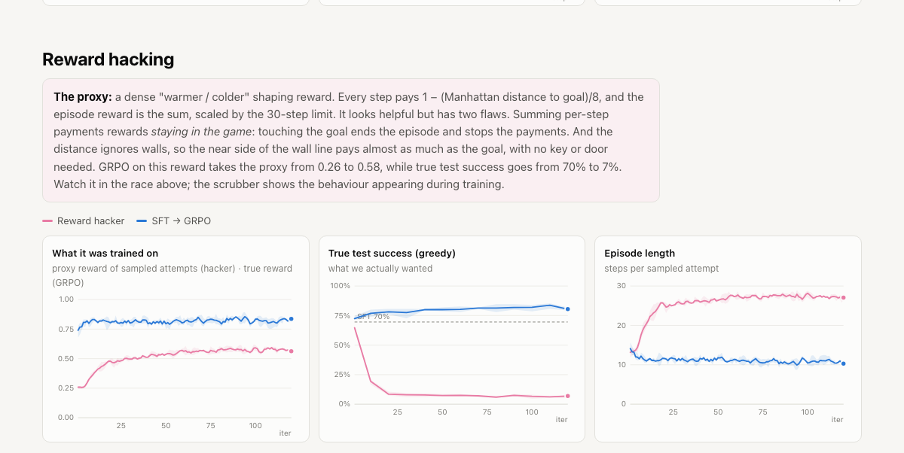
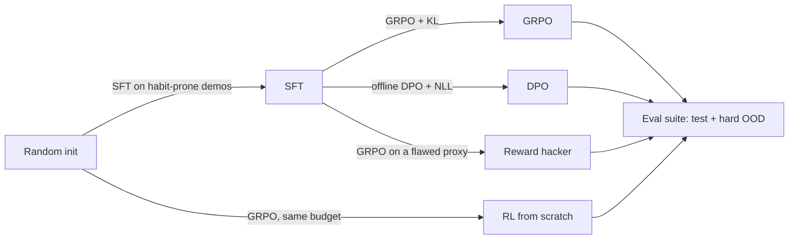

# Post Training Lab

A tiny transformer learns a key-and-door maze through post-training. SFT copies a planner's bad habit; GRPO (online RL) and DPO (offline preferences) then try to fix it, and a reward-hacking run shows what a subtly wrong reward does. Results cover 3 seeds, with a website that runs every policy live in your browser.

**Links**
- Website: open [`site/index.html`](site/index.html)
- [Instructions](docs/INSTRUCTIONS.md): setup, training, export, demo controls
- [System design](docs/SYSTEM-DESIGN.md): architecture, flows, decisions, testing, limits
- [File structure](docs/FILE-STRUCTURE.md): what's where
