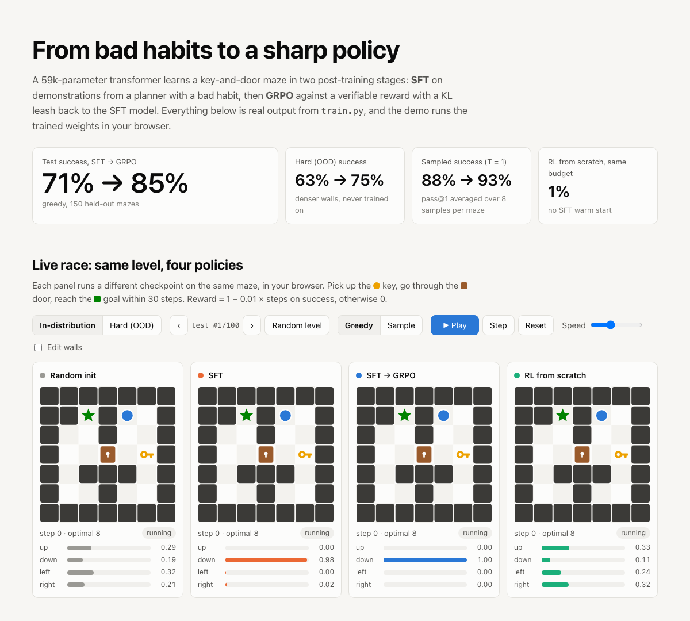
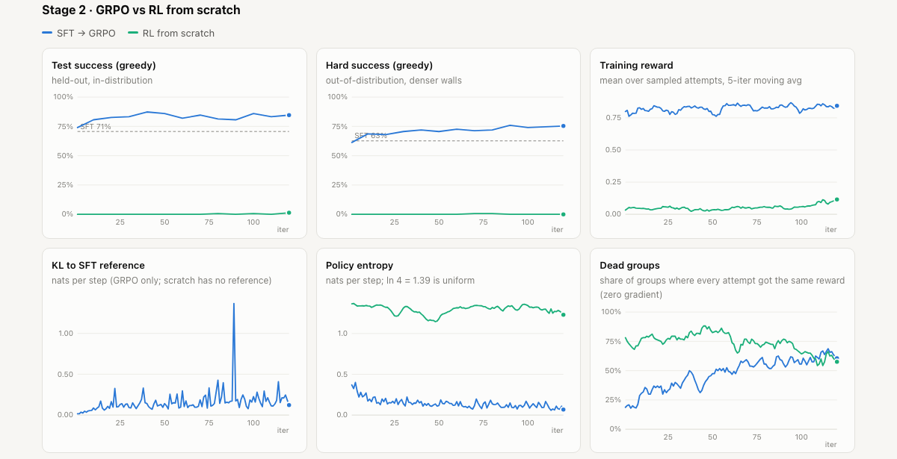
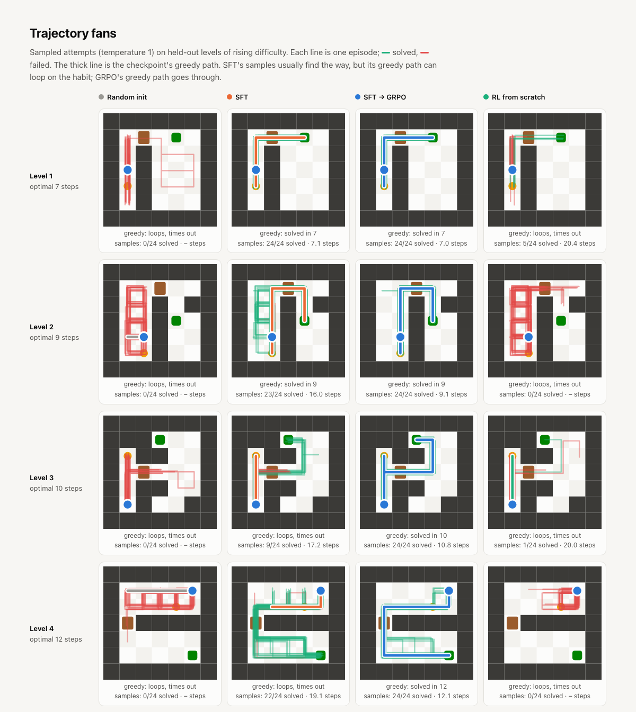
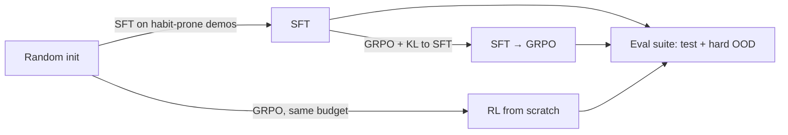

# Post Training Lab

A tiny transformer learns a key-and-door maze in two post-training stages: SFT on demos from a planner with a bad habit, then GRPO against a verifiable reward. It comes with a held-out eval suite and a website that runs the trained policies live in your browser.

**Links**
- Website: open [`site/index.html`](site/index.html)
- [Instructions](docs/INSTRUCTIONS.md): setup, training, viewing, demo controls
- [System design](docs/SYSTEM-DESIGN.md): architecture, flows, decisions, testing, limits
- [File structure](docs/FILE-STRUCTURE.md): what's where
