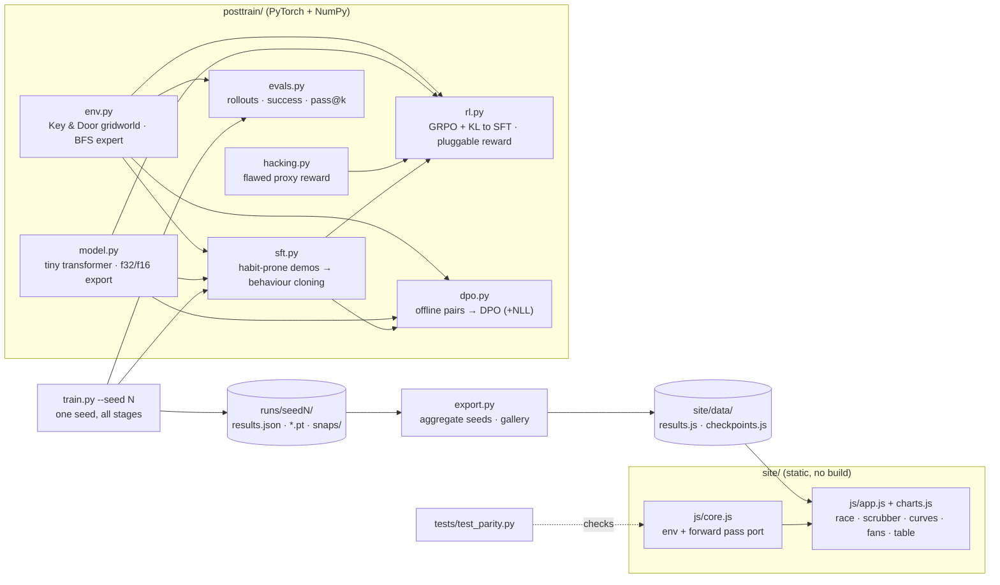

# System Design

Post Training Lab is a small, complete post-training pipeline you can run on a
laptop CPU. It has four parts: a gridworld with a verifiable reward; a trainer
that runs SFT and then compares GRPO, DPO and a reward-hacking GRPO run; an
exporter that aggregates several seeds; and a static website that runs the
trained policies live and plots their training.

## Architecture

## Components

| Component | Job |
|---|---|
| `posttrain/env.py` | 7×7 grid (5×5 interior), 30-step limit. Level generator (two distributions: `train` and the denser `hard`), vectorised `BatchEnv`, the true reward (1 − 0.01 × steps on success, else 0), and a BFS expert that gives optimal paths. |
| `posttrain/model.py` | Pre-LayerNorm transformer (d=48, 4 heads, 3 layers, ReLU MLP, ~59k params). Reads 26 tokens (CLS + 25 interior cells) and outputs 4 action logits off CLS. Exports weights as base64 float32, or float16 for training snapshots. |
| `posttrain/sft.py` | Generates demos from a planner with a *habit*: 80% of the time it walks straight at its target instead of planning, and that action is the label. Keeps only episodes that reached the goal, trains with cross-entropy, and filters training levels against the eval sets. |
| `posttrain/rl.py` | GRPO: group of 8 attempts per level, group-normalised advantages, PPO-clipped surrogate (4 full-batch epochs per iteration), exact KL to a frozen reference, logs dead-group share. `reward_fn` swaps in a different reward; the true reward is still logged. |
| `posttrain/dpo.py` | Offline DPO. Samples 8 attempts per level from frozen SFT once, then pairs the shortest solved attempt (chosen) with a failed one, or else a much longer one (rejected). Trajectory log-prob = sum of action log-probs. Optional NLL on the chosen trajectory (RPO-style). |
| `posttrain/hacking.py` | The flawed proxy: per-step closeness to the goal (Manhattan, walls ignored), summed over the episode and scaled by the step limit. |
| `posttrain/evals.py` | Batched rollouts and the eval suite: greedy success, unbiased pass@8, sampled success, efficiency, mean reward on fixed `test` and `hard` sets. |
| `train.py` | One seed: SFT, then GRPO, DPO (+NLL), plain DPO, reward hacker and RL from scratch. Saves checkpoints, GRPO/hacker snapshots every 20 iterations, and per-stage evals including the proxy score. |
| `export.py` | Reads every finished `runs/seed*/`, keeps metrics and curves per seed, builds the trajectory gallery and difficulty buckets from seed 0, and writes `site/data/`. |
| `site/js/core.js` | JavaScript port of the env rules, BFS, the exact forward pass, and float16 decoding. Also loads in Node for the parity test. |
| `site/js/app.js`, `charts.js` | Renders the page: tiles, the four-panel race with per-panel checkpoint pickers and the training scrubber, the diagram, line charts (mean + min–max band, hover), the DPO and hacking sections, trajectory fans, the eval table (mean ± sd), and notes generated from the numbers. |

## Main flows

**Training (`train.py --seed N`, run once per seed, in parallel if you like)**
1. Build the eval suite: 150 `test` and 150 `hard` levels from fixed seeds (identical across training seeds). Hash them.
2. Run the habit-prone demonstrator on 3,000 fresh training levels (seed-dependent), skipping eval levels, and keep the successful episodes.
3. SFT for 1,500 AdamW steps (one-cycle LR).
4. **GRPO** from SFT for 120 iterations: 32 fresh levels × 8 attempts, group advantages, 4 full-batch clipped epochs with KL(β=0.02) to frozen SFT. A snapshot is saved every 20 iterations.
5. **DPO**: sample 3,840 levels × 8 attempts from SFT (the same episode count GRPO uses), build pairs, then train 3 epochs with β=0.1 and lr 1e-4. This runs twice, with NLL weight 1.0 (`dpo`) and 0 (`dpo_plain`).
6. **Reward hacker**: identical to step 4, but trained on the proxy reward (snapshots too).
7. **RL from scratch**: GRPO from the same random init, no KL.
8. Score every checkpoint on the true metrics and the proxy, then write `runs/seedN/`.

**Export (`export.py`)**: aggregates the seeds and rebuilds the gallery (24 samples + a greedy run per checkpoint on 4 test levels). It writes `results.js` plus `checkpoints.js`, which holds the float32 final checkpoints and the float16 snapshots.

**Viewing (`site/index.html`)**: data loads as plain scripts, so the page works from `file://`. Each race panel runs `Core.forward` each tick. The scrubber points GRPO and reward-hacker panels at a snapshot; its last position is the float32 final checkpoint.

## Where data lives

| Data | Location | Notes |
|---|---|---|
| Per-seed metrics, histories, DPO pair stats | `runs/seedN/results.json` | One file per seed. |
| Trained weights | `runs/seedN/*.pt`, `runs/seedN/snaps/*.pt` | Seven stages plus GRPO/hacker snapshots. |
| Website data | `site/data/results.js`, `site/data/checkpoints.js` | Built by `export.py`. Live demo and snapshots come from seed 0. |
| Logs | `runs/train_seedN.log` | One per seed. |
| First single-seed run (v1) | `runs_v1/` | Archived for reference; not used by the site. |
| Smoke-test output | `runs_quick/` | From `--quick`; `export.py --quick` publishes it to the site (and is overwritten by the next full export). |

## Key design decisions and trade-offs

- **Hand-written transformer instead of `nn.TransformerEncoder`.** It lets the browser run the
  exact same forward pass (verified to ~1e-6), at the cost of a little extra code.
- **A systematic habit, not random noise, in the demos.** The first version used uniformly
  random label noise (20%). Greedy decoding strips uniform noise for free, so what was left for RL
  were scattered capacity errors, which GRPO could not fix within budget. A *habit* (walk straight
  at the target) is the most likely action in many states, so greedy decoding keeps it and loops
  against walls. SFT's samples still contain the planner's behaviour (high pass@8), and RL has one
  consistent thing to shift.
- **7×7 grid, 30-step limit (down from 9×9 and 50).** On 9×9, measured policy-gradient cosine
  similarity across independent 24-level batches was ≈ 0.03 for a binary reward. That is too noisy
  at CPU-sized batches, even though RL could overfit 16 fixed levels to 100%. Halving the horizon
  fixed it and made every stage ~3× cheaper.
- **Full-batch PPO epochs.** Minibatching one iteration's ~5k steps made most Adam steps noise.
- **Std normalisation kept.** With the step-cost reward, measured gradient consistency was higher
  *with* it (cosine 0.24 vs 0.08), so it stays on, unlike Dr. GRPO.
- **DPO with an NLL term.** In trials, plain DPO hit ~90% preference accuracy while *both*
  chosen and rejected log-likelihoods fell (−6 and −31 nats), and greedy success collapsed from
  75% to 28%. Adding the chosen trajectory's NLL (weight 1) held chosen log-ratios near 0 and
  improved success to ~83%. Both variants are trained and shown, because the collapse is a lesson in itself.
- **DPO gets the same episode budget as GRPO, all up front.** That isolates online vs offline as the
  difference. It is not compute-matched: DPO's training steps are cheaper.
- **A summed, not averaged, shaping proxy.** An averaged closeness proxy was tried first: it only
  mildly favoured hovering (~0.7 vs ~0.6), and 40 iterations of GRPO barely moved it. Summing
  per-step payments is the classic real-world bug: staying in the game always pays, so the hack
  appears within ~10 iterations.
- **Seeds in parallel, 2 threads each.** On this CPU, more torch threads barely help, so separate
  processes use the cores better than one wide process.
- **Float16 snapshots.** They halve the page weight of the 14 scrubber checkpoints. The final
  checkpoints stay float32, and the parity test covers both.
- **Exact KL over 4 actions.** It is cheaper and lower-variance than sampled estimators here.
- **Eval levels hashed and excluded from training.** A small contamination guard.
- **Static site, data as `.js`.** No server or build step; checkpoints make the page a few MB.

## Testing

- `tests/test_env.py`: the expert solves every generated level in exactly its path length, and
  rewards match; the door blocks without the key; training levels never collide with eval
  levels; pass@k edge cases.
- `tests/test_parity.py`: replays Python-recorded episodes through `site/js/core.js` in Node and
  checks observations, end states and logits (tolerance 1e-4), for float32 and float16 weights.
- `train.py --quick` and `export.py --quick`: an end-to-end smoke run (minutes on an idle machine).
- Every number in the page's tiles, captions and notes is computed from `results.js`, and the
  plain-DPO note only claims "both likelihoods fell" when the data shows it.
- Manual check: open `site/index.html`, run the race, and drag the scrubber.

## Known limits

- Three seeds. The bands show best and worst seed, not a confidence interval.
- The efficiency metric (optimal ÷ taken steps) is 1.00 for every checkpoint: a deterministic greedy
  policy either takes the shortest route or loops until timeout.
- A 7×7 maze is small (optimal paths average ~8 steps); the scale was chosen to fit a laptop CPU.
- Small eval sets (150 levels each), so one level is worth about 0.7 points of success.
- The `hard` split varies only wall density: a mild shift, not a new task.
- DPO and the reward hacker use hyper-parameters picked from one short trial each on seed 0.
- The browser forward pass is unoptimised JS (~10 ms per step): fine for 4 panels, not for batch eval.
- A full three-seed run takes hours on the 2019 Intel laptop it was built on, and much longer under load.
